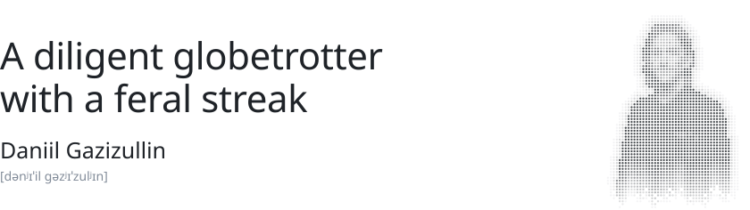
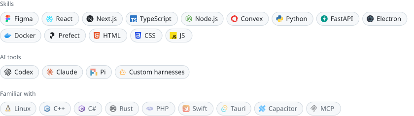

<picture>
  <source media="(prefers-color-scheme: dark)" srcset="assets/header-dark.svg" />
  
</picture>

I build vulnerable services for Standoff, study at Innopolis University and make small silly tools.

<a href="https://www.linkedin.com/in/daniil-gazizullin/"><picture><source media="(prefers-color-scheme: dark)" srcset="assets/btn-linkedin-dark.svg" /></picture></a>
<a href="https://avx.so/AGENTS.md"><picture><source media="(prefers-color-scheme: dark)" srcset="assets/btn-agents-dark.svg" /></picture></a>

 

<picture>
  <source media="(prefers-color-scheme: dark)" srcset="assets/stack-dark.svg" />
  
</picture>

 
 
 

<a href="https://avx.so">
  <picture>
    <source media="(prefers-color-scheme: dark)" srcset="assets/avx-dark.svg" />
    
  </picture>
</a>
